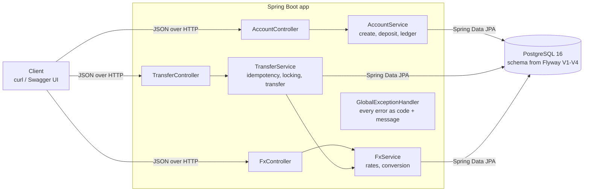
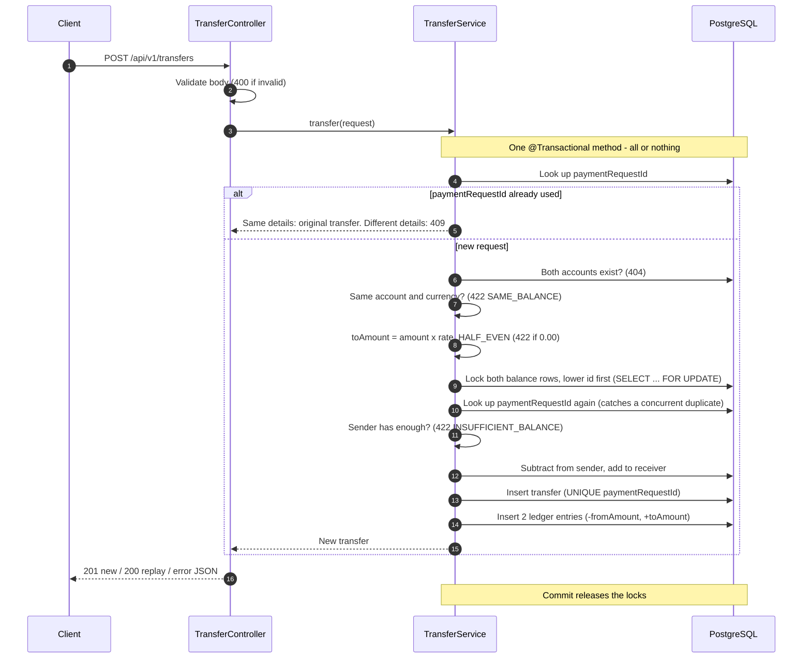
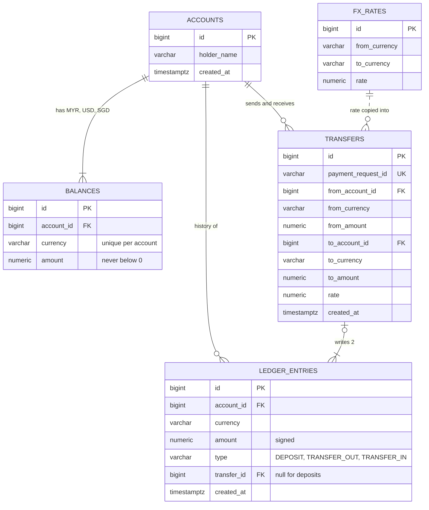

# JustPay

A backend API for multi-currency wallets, built as a learning project. Each account holds
MYR, USD and SGD balances; money can be deposited, transferred between accounts, and converted
between currencies at fixed rates. Transfers are idempotent: retrying a request never moves money twice.

## Core features

- **Multi-currency accounts.** Creating an account opens three balances (MYR, USD, SGD) at 0, in one transaction.
- **Deposits.** Add money to any one balance of an account.
- **Transfers.** Send money to another account, in the same currency or a different one. The receiver gets
  `amount × rate`, rounded once to 2 decimal places, and the transfer stores the rate it used.
- **Conversion.** Move money between your own balances (e.g. USD → MYR) as a transfer to the same account.
- **Idempotency.** Every transfer carries a `paymentRequestId`. Sending the same request again returns the
  original transfer and moves no money; reusing the id with different details is rejected with `409`.
- **Ledger.** Every balance change writes an entry that is never edited or deleted, so each balance always
  equals the sum of its ledger entries.
- **Safe under concurrency.** Transfers lock both balance rows, so two requests cannot spend the same money
  or deadlock each other.

## Endpoints

| Method | Path | Purpose |
|---|---|---|
| POST | `/api/v1/accounts` | Create an account with MYR, USD and SGD balances at 0 |
| GET | `/api/v1/accounts/{id}` | Get an account and its balances |
| POST | `/api/v1/accounts/{id}/deposits` | Deposit `{currency, amount}` into one balance |
| POST | `/api/v1/transfers` | Transfer between accounts, or convert within one account |
| GET | `/api/v1/transfers/{id}` | Get a transfer |
| GET | `/api/v1/accounts/{id}/ledger` | Ledger entries, newest first; optional `?currency=` |
| GET | `/api/v1/fx/rates` | The fixed exchange rates |

Interactive docs: Swagger UI at http://localhost:8080/swagger-ui.html once the app is running.

## Example

```bash
# Create two accounts (ids 1 and 2 on a fresh database)
curl -X POST localhost:8080/api/v1/accounts -H "Content-Type: application/json" -d '{"holderName": "Alice"}'
curl -X POST localhost:8080/api/v1/accounts -H "Content-Type: application/json" -d '{"holderName": "Bob"}'

# Deposit 100 USD into Alice's account
curl -X POST localhost:8080/api/v1/accounts/1/deposits -H "Content-Type: application/json" \
  -d '{"currency": "USD", "amount": 100.00}'

# Send 10.01 USD from Alice; Bob receives MYR (10.01 × 4.4 = 44.044 → 44.04)
curl -X POST localhost:8080/api/v1/transfers -H "Content-Type: application/json" \
  -d '{"paymentRequestId": "pr-001", "fromAccountId": 1, "fromCurrency": "USD",
       "toAccountId": 2, "toCurrency": "MYR", "amount": 10.01}'

# Convert 20 USD to MYR inside Alice's account
curl -X POST localhost:8080/api/v1/transfers -H "Content-Type: application/json" \
  -d '{"paymentRequestId": "pr-002", "fromAccountId": 1, "fromCurrency": "USD",
       "toAccountId": 1, "toCurrency": "MYR", "amount": 20.00}'

# Alice's ledger, USD only
curl "localhost:8080/api/v1/accounts/1/ledger?currency=USD"
```

Sending the same transfer request again returns the original transfer with status `200` instead of `201`,
and no money moves.

## Business rules

- Amounts must be greater than 0 with at most 2 decimal places. Money is `BigDecimal` / `NUMERIC(19,2)`.
- Cross-currency amounts are `amount × rate`, rounded once to 2 decimal places with `HALF_EVEN`.
  Each transfer stores the rate it used.
- Rates are seeded so that converting there and back never gains money:

  | From → To | Rate | From → To | Rate |
  |---|---|---|---|
  | USD → MYR | 4.40 | MYR → USD | 0.22 |
  | SGD → MYR | 3.30 | MYR → SGD | 0.30 |
  | USD → SGD | 1.30 | SGD → USD | 0.76 |

- A transfer runs in one database transaction. Both balance rows are locked
  (`SELECT … FOR UPDATE`), lower id first, so concurrent transfers cannot overspend or deadlock.
- Every balance change writes a ledger entry. Ledger entries are never updated or deleted.

## Errors

Every error has the same shape:

```json
{ "code": "INSUFFICIENT_BALANCE", "message": "Balance USD has 10.00, needs 10.01" }
```

| Status | Code | When |
|---|---|---|
| 400 | `INVALID_REQUEST` | Missing or invalid field, malformed JSON, bad amount |
| 400 | `UNSUPPORTED_CURRENCY` | Currency other than MYR, USD, SGD |
| 404 | `ACCOUNT_NOT_FOUND` | Unknown account id |
| 404 | `TRANSFER_NOT_FOUND` | Unknown transfer id |
| 409 | `PAYMENT_REQUEST_ID_CONFLICT` | `paymentRequestId` reused with different details |
| 422 | `SAME_BALANCE` | Same account and same currency |
| 422 | `INSUFFICIENT_BALANCE` | Sender balance too low |
| 422 | `AMOUNT_TOO_SMALL` | Converted amount rounds to 0.00 |

## Architecture

### Overview

Every request goes controller → service → repository → PostgreSQL. Controllers only validate input and
map results to JSON; services hold the business rules and the database transactions.



### Transfer flow

`POST /api/v1/transfers` runs as one database transaction: either every step below happens, or none of them do.



### Data model



Each balance always equals the sum of its ledger entries. Deposits add one entry; transfers add two.
The dotted line means no foreign key: `transfers.rate` is a copy of the rate used, not a link to `fx_rates`.

## Tech stack

Java 21 · Spring Boot 3.5 · Maven · PostgreSQL 16 · Spring Data JPA · Flyway ·
JUnit 5 · Testcontainers · MockMvc · springdoc-openapi · GitHub Actions

## Prerequisites

- JDK 21 or newer
- Docker (Docker Desktop on Windows/macOS) — used by Docker Compose and by the tests

## Run

```bash
docker compose up -d        # PostgreSQL 16 on localhost:5433
./mvnw spring-boot:run      # Windows PowerShell: .\mvnw.cmd spring-boot:run
```

Flyway creates the schema and seeds the FX rates on first start.

- API: http://localhost:8080
- Swagger UI: http://localhost:8080/swagger-ui.html

Stop the database with `docker compose down` (add `-v` to delete its data).

## Test

```bash
./mvnw verify
```

Integration tests start their own PostgreSQL container through Testcontainers, so Docker must be running.
The local database from Docker Compose is not used. After every test, a check confirms that each
balance equals the sum of its ledger entries.

## Project structure

```
src/main/java/com/justpay/
  account/    accounts, balances, deposits, ledger endpoint
  transfer/   transfers, idempotency, locking
  ledger/     ledger entries
  fx/         exchange rates and conversion
  common/     Currency, errors, timestamps
src/main/resources/db/migration/   Flyway migrations V1–V4
docs/         build plan and step-by-step development log
```

## Out of scope

Live exchange rates, authentication, frontend, refunds, withdrawals, real payment providers.
